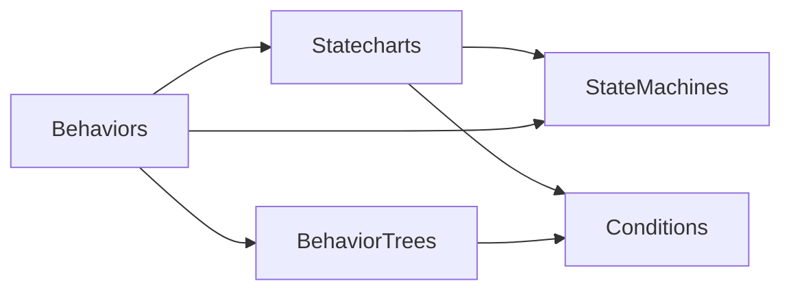

# Statecharts and composable behaviors

This round builds on the toolkit in PR #11. The flat state machine remains a small pure transition kernel. Four optional modules add shared conditions, statecharts, behavior trees and composition. All target .NET 10 and .NET Standard 2.1 with framework LangVersion=latest and no engine or new NuGet dependency.

## Choose the required capabilities

| Use | Module | Per-agent execution storage |
| --- | --- | --- |
| Open/closed chest | StateMachines | The host's StateId value, four bytes of payload. The definition is shared; no runner, timer or callback is required. |
| Hierarchical character controller | Statecharts | Active configuration and event workspace sized by the maximum simultaneously active configuration. |
| Memory behavior tree | BehaviorTrees | Sixteen-byte frames per maximum path depth, plus required condition scratch and object/array headers. |
| Reactive behavior tree | BehaviorTrees | Adds a path snapshot only for reactive paths that can reach a running action. |
| Logical guards | Conditions | Immutable program shared by agents; caller-owned bool scratch. A lone predicate or constant requires none. |
| Nested AI graph | Behaviors | Explicitly configured runtime components and sparse bindings, retaining their reserved workspaces while inactive. |

The composition graph reserves its configured children so switching states does not allocate. Its total memory is the sum of those runtimes, not only the graph's currently active path. Mutable runtime instances belong to one binding occurrence; immutable definitions can be shared by many actors. Choose the standalone kernel or runner when composition is unnecessary.

Only the integration module references both tree and state runtimes. The [player examples](../samples/Bezoro.Statecharts.ConsoleDemo/README.md) use state machines and the existing scheduler without behavior trees. The [NPC example](../samples/Bezoro.Behaviors.ConsoleDemo/README.md) uses their composition.

## Event, frame and interval decisions

Statecharts evaluate explicit signals. They examine active sources with matching transitions, rather than traversing every declared state or condition. Higher-priority selected transitions suppress structurally conflicting sources before their guards execute. Guards read the unchanged configuration before lifecycle effects begin.

The host chooses how to produce a signal. Input or gameplay events can dispatch it directly. A dedicated CheckMovement signal can be dispatched each frame. The existing TickScheduler can deliver CheckVision every 500 ms. Its clock/heap check is host work; the vision condition runs only when the scheduled signal is delivered. The runner installs no hidden polling loop or timer.

Tag scheduled observations with the owning StateActivation, cancel pending scheduler handles when the state exits, and validate tokens again when work is delivered. A state reentered with the same numeric ID has a new activation. Reschedule periodic work from the current observation time or define an explicit catch-up policy; avoid replaying old perception observations in a stalled frame.

## Conditions and tree priorities

Conditions use integer predicate IDs and a typed C# evaluator. The evaluator can express numeric comparisons, null checks, flags, collection lookups or any other synchronous boolean computation. All, Any, Not, Xor, Equal and Choose compose those predicates. All/Any/Choose short-circuit; constants remove statically unreachable branches while preserving observable predicate order. Definitions use bounded iterative compilation and evaluation, without reflection or dynamic string execution.

Predicates must observe context rather than changing it or mutating the runner. Typed readonly input parameters protect struct contexts; reference contexts still require that discipline. Keep expensive queries on the event/interval schedule that needs them. Custom callbacks determine their own processing and allocation costs.

Tree sequences and selectors use memory by default. A successful prefix remains complete while its selected action is Running. Explicit ReactiveSequence/ReactiveSelector nodes recheck priorities on the next evaluation cycle and interrupt an action if another branch wins. A native Subtree occurrence has independent execution state; compiled metadata is expanded by occurrence and shared between agents through the resulting definition.

## Budget and continuation

One mutable BehaviorBudget is passed by reference through a composed graph. Visits bound interpreter evaluations, not elapsed milliseconds or arbitrary host work. A condition program and synchronous statechart transition are atomic bounded operations; resource cleanup also completes outside the evaluator allowance.

Budget exhaustion suspends the exact evaluator position. A parent does not repeatedly spend every new quantum before its child can advance. A normal Running yield returns control to reactive priorities; an unfinished budget continuation resumes its current cycle first. Small budgets therefore trade response latency for bounded evaluator work. Use explicit statechart signals for urgent interruptions, and select a budget appropriate to the graph's depth and application frame limits.

Compiled trees/conditions and native chart hierarchies use iterative traversal. Cross-runtime adapters use managed calls and have an explicit composition depth default of 32, supported ceiling of 64, and configurable component limit. These limits count runtime components; they do not turn a declared hierarchy into a task or coroutine per state.

## Activation, interruption and failure

Tree Start creates execution frames; action Enter occurs during its first budgeted Tick. A chart Start enters its initial active regions. State entry starts its bound child and exit stops it. Machine-as-task completion requires explicit success/failure states; an unmapped machine remains Running. A terminal child within an ordinary state is retained without being ticked again until that state exits or an optional completion signal changes it.

A whole composition returning Success or Failure closes all started activity before returning and latches its result. Stop resets that result without repeating cleanup. Statechart ActiveStates is empty after terminal cleanup; the flat adapter retains CurrentState for inspection.

Exit plans revoke the activations they will remove before cancellation callbacks run. Ancestor binding scopes participate in token validation, so stopping one region cannot accept an old completion from another region that is also scheduled to leave. Unaffected orthogonal regions remain live. StateId membership views may still show a partially unwound configuration during callbacks; activation tokens answer whether delayed work is still authorized.

Serialize all operations and token checks on an owner's execution thread. Marshal asynchronous results to that owner before querying liveness or modifying its context. The libraries do not create background tasks or provide lock-free concurrent mutation. Independent actors may run on different workers when their contexts and handlers permit it; Unity/Godot scene access remains on the engine thread.

Cleanup is attempted once per activation and continues through other started children when a callback throws. Effects already performed by application code cannot be rolled back. Faulted runners require their documented Stop/Reset before reuse. Guard failures before mutation preserve the chart configuration. Reentrant mutation is rejected; a host that needs signals raised during callbacks should queue them explicitly and drain them after the current operation.

## Validation evidence

The complete local Linux Release build passed with zero warnings/errors. All **3,137 tests passed across 19 suites**, with no failures or skipped tests, including Stockfish 19 integration. Conditions, Statecharts, BehaviorTrees and Behaviors also passed their module suites with checked arithmetic.

The new suites contain 22 condition, 54 statechart, 43 tree and 37 composition tests. They cover short-circuit order, inactive branches, ancestor exits, parallel regions, budget-one progress, lifecycle failure, stale tokens, ownership, and warmed allocation checks.

Independent reference models supplemented the suites:

- 96,000 condition evaluations checked both result and exact predicate order.
- 160,000 chart dispatches checked 157,717 transitions and 321,066 predicate traces.
- 80,000 tree updates and 71,954 restarts checked exact Enter/Tick/Exit/Abort traces.
- Mixed composition chains through depth 64 checked budget-one progress, priority recovery, fault cleanup, and late completion rejection.
- 400,000 warmed ticks across memory, reactive, parallel and deeply mixed graphs measured zero managed allocation in those scenarios.

The two console examples executed their assertions. The current C# 9 consumer compiles the public APIs; a real Roslyn 3.8 compiler also compiled and executed all three consumers against a .NET Standard 2.1 snapshot, returning 4, 4 and 2. These are bounded host/compiler checks and do not prove every thread interleaving or engine/player behavior.

## Examples

The statechart example opens and closes a chest, keeps Grounded.Walking active during an additive hit reaction, and requests an impulse for an airborne hit. Health changes once per accepted damage event. Movement intent, impulses and animation layers are outputs for an engine adapter to combine.

The NPC example runs BT -> statechart -> BT -> flat FSM -> BT and a compiled subtree. Scheduled perception interrupts patrol once, and the combat graph completes aiming and attacking. It also executes the C# 9 consumer with a one-visit budget.

Managed builds, tests and compiler checks do not establish Unity Editor, IL2CPP or Godot export compatibility. Validate intended engine/player targets and stripping settings. Development pushes do not run CI; main integration validates all discovered suites on both platforms before UPM publication.
